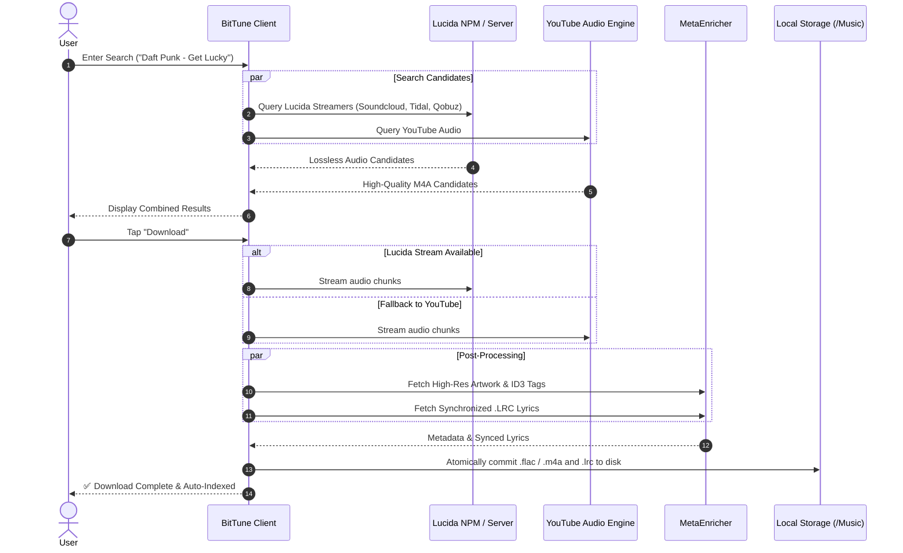
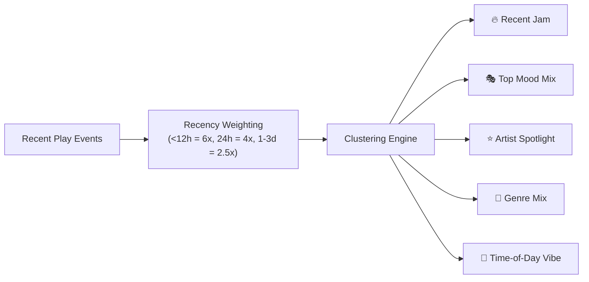
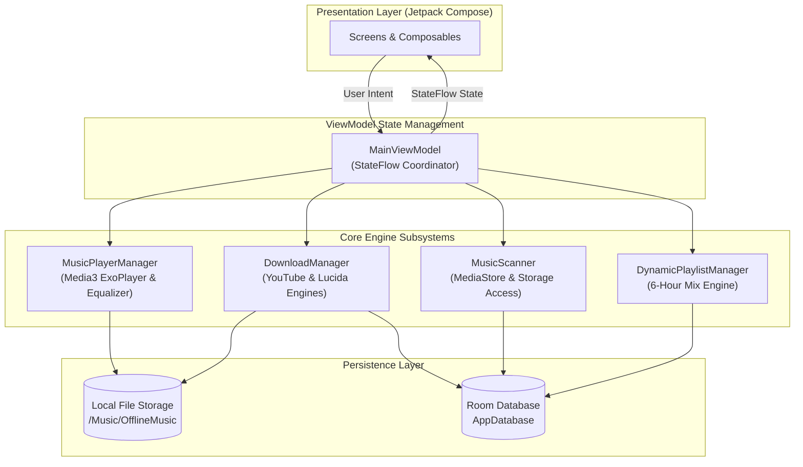

<div align="center">


# 🎵 BitTune (OfflineMusic)
### *Quiet listening. 100% offline, privacy-first, lossless audio player & archiver for Android.*

[-3DDC84?style=for-the-badge&logo=android&logoColor=white)](https://developer.android.com)
[](https://kotlinlang.org)
[](https://developer.android.com/jetpack/compose)
[](https://developer.android.com/media/media3)
[](https://developer.android.com/training/data-storage/room)
[](https://www.npmjs.com/package/lucida)
[](#-license)

<br/>

[✨ Features](#-key-features) •
[🧭 Tour & Tutorial](#-what-is-everything-app-tour) •
[📥 Download Engine](#-multi-source-download-engine) •
[⏱️ 6h Dynamic Mixes](#️-6-hour-dynamic-mix-engine) •
[📊 Analytics](#-detailed-listening-statistics) •
[🚀 Quick Start](#-getting-started) •
[📚 Documentation](#-documentation-links)

</div>

---

## 📖 Overview

**BitTune** is a modern, open-source Android music player engineered for listeners who cherish their audio collection. It marries the aesthetics of an independent record store with bleeding-edge audio architecture: **100% offline playback**, **lossless streaming and downloads** (FLAC, AAC, 320kbps MP3), **line-by-line synchronized LRC lyrics**, **automated metadata enrichment**, and **autonomous 6-hour dynamic playlists** generated strictly from on-device listening telemetry.

> [!NOTE]
> **No Subscriptions. No Telemetry. No Ads.**
> All downloaded audio files and metadata reside permanently in your device's local `/Music/OfflineMusic` folder. You own your music forever.

---

## 📑 Interactive Table of Contents

- [✨ Key Features](#-key-features)
- [🧭 What is Everything? (App Tour)](#-what-is-everything-app-tour)
- [📥 Multi-Source Download Engine](#-multi-source-download-engine)
- [⏱️ 6-Hour Dynamic Mix Engine](#️-6-hour-dynamic-mix-engine)
- [📊 Detailed Listening Statistics](#-detailed-listening-statistics)
- [🎛️ Audio Engine & 5-Band Equalizer](#️-audio-engine--5-band-equalizer)
- [⚔️ Feature Comparison Matrix](#️-feature-comparison-matrix)
- [🏗️ Architecture & Data Flow](#️-architecture--data-flow)
- [🚀 Getting Started](#-getting-started)
- [📁 Project Structure](#-project-structure)
- [📚 Documentation Links](#-documentation-links)
- [❓ Frequently Asked Questions](#-frequently-asked-questions)
- [🤝 Contributing](#-contributing)
- [📄 License](#-license)

---

## ✨ Key Features

<details open>
<summary><b>🔥 Click to expand / collapse Core Feature Highlights</b></summary>
<br/>

- 📶 **100% Offline Autonomy**: Once downloaded, songs play with zero internet connectivity required.
- 💎 **Lossless Audio Streaming & Rip**: Powered by **YouTube Audio** and the official [`lucida`](https://www.npmjs.com/package/lucida) modular engine (Soundcloud, Tidal, Qobuz, Deezer).
- ⚡ **Stream-While-Downloading**: Start listening immediately as audio streams buffer in real-time, while full file archival proceeds concurrently in the background.
- 📦 **1-Click Spotify Playlist Importer**: Paste any public Spotify playlist link to automatically resolve, fuzzy-match, and batch download all songs.
- 🎨 **Automated Metadata & High-Res Artwork**: Auto-enriches tracks with canonical artists, clean titles, high-resolution covers, release dates, and genres via MetaEnricher.
- 🎤 **Karaoke Synced (.LRC) Lyrics**: Line-by-line synchronized lyrics auto-fetched from MetaEnricher and LRCLIB with interactive jump-to-timestamp.
- ⏱️ **6-Hour Dynamic Mixes**: Ephemeral smart playlists generated every 6 hours using a recency-decay mathematical scoring algorithm.
- 📊 **In-Depth Listening Analytics**: Track total hours, play counts, favorite artists, top moods, and weekly trends.
- 🎛️ **Hardware-Accelerated 5-Band Equalizer**: Custom frequency adjustments (60Hz–14kHz) with built-in presets (Bass Boost, Vocal, Rock, Pop, etc.).
- 🛡️ **Intelligent Duplicate Resolution**: Interactive prompt to Replace, Keep Both, or Discard duplicate tracks without clobbering existing playlist entries.
- 🎨 **Independent Record-Store Aesthetics**: Hand-crafted Material 3 design system with customizable Dark, Light, AMOLED, and Sage themes.

</details>

---

## 🧭 What is Everything? (App Tour)

BitTune is designed with zero clutter. Here is a breakdown of every section:

```
┌────────────────────────────────────────────────────────────────────────┐
│                        BITTUNE NAVIGATION TABS                         │
├──────────────┬──────────────┬──────────────┬──────────────┬────────────┤
│   🏠 HOME    │  📚 LIBRARY  │   🔍 SEARCH  │   📊 STATS   │ ⚙️ SETTINGS │
├──────────────┼──────────────┼──────────────┼──────────────┼────────────┤
│ • 6h Mixes   │ • All Songs  │ • YouTube    │ • Play Counts│ • Folder   │
│ • Recent Jam │ • Playlists  │ • Lucida     │ • Total Hours│ • Equalizer│
│ • Mood Mix   │ • Artists    │ • Spotify URL│ • Top Artists│ • Themes   │
│ • Quick Play │ • Albums     │ • Batch Rip  │ • Mood Trends│ • Tutorial │
└──────────────┴──────────────┴──────────────┴──────────────┴────────────┘
```

<details>
<summary><b>🔍 Click for deep dives on each tab</b></summary>

### 🏠 1. Home
- **6-Hour Dynamic Mixes**: Smart playlists that regenerate every 6 hours (*Recent Jam*, *Top Mood Mix*, *Artist Spotlight*, *Genre Mix*, and *Time-of-Day Vibe*).
- **Recent Jam**: A prioritized playlist featuring the tracks you've been obsessing over in the last 12–24 hours.
- **Favorites & Quick Play**: One-tap resumption of your top replayed offline library tracks.

### 📚 2. Library
- **Songs, Playlists, Artists, Albums**: Intuitive sub-tabs to browse your offline music files.
- **Top of Liked Playlist**: Newly liked songs are automatically pinned to the very top.
- **Multi-Criteria Sorting**: Sort any playlist by *Time Added*, *Time Downloaded*, *Most Listened*, *Mood*, or *Genre*.

### 🔍 3. Search & Downloader
- **Unified Online Search**: Search across YouTube and Lucida Lossless simultaneously.
- **Spotify Batch Importer**: Paste any Spotify playlist URL; the app parses every track and queues them for downloading.
- **No Cloudflare Captchas**: The old fragile HTML scraping mechanism has been completely replaced with direct API and NPM streaming.

### 📊 4. Statistics & Tracking
- **Granular Listening Telemetry**: Play counters and total listening hours per song, artist, album, and mood.
- **Visual Analytics**: Interactive cards highlighting your top artists, most replayed tracks, and daily listening habits.

### ⚙️ 5. Settings
- **Audio Folder Access**: Select custom music directories using Android's Storage Access Framework.
- **5-Band Equalizer**: Tune sound profiles with pre-configured presets or manual slider gains.
- **Beginner Tutorial & Guide**: Replay the interactive 4-step onboarding guide anytime.

</details>

---

## 📥 Multi-Source Download Engine

BitTune connects to multiple streaming backends with seamless automatic failover:



> [!TIP]
> For detailed technical specifications on fuzzy matching algorithms and duplicate resolution, read [`docs/DOWNLOAD_ENGINE.md`](docs/DOWNLOAD_ENGINE.md).

---

## ⏱️ 6-Hour Dynamic Mix Engine

BitTune features a **self-evolving, ephemeral playlist engine** that recalculates every 6 hours based on a recency-decay scoring formula:

$$\text{Score}(t) = \sum_{e \in \text{Events}(t)} w(\Delta t_e) \cdot \text{DurationWeight}(e)$$



> [!TIP]
> For mathematical proofs and cluster selection rules, see [`docs/DYNAMIC_MIXES.md`](docs/DYNAMIC_MIXES.md).

---

## 📊 Detailed Listening Statistics

BitTune logs playback events locally in Room DB to provide transparent insight into your listening habits:

| Metric | Description | Purpose |
| :--- | :--- | :--- |
| **Play Count** | Increment counter per track completion | Identifies all-time and weekly favorite tracks |
| **Hours Played** | Exact duration listened per song/artist | Accurate tracking that avoids skew from short interludes |
| **Mood Analysis** | Classifies tracks into *Happy*, *Chill*, *Energetic*, *Sad*, *Romantic* | Drives mood-based dynamic mixes and mood sorting |
| **Genre Distribution** | Quantifies listening time per musical genre | Powers Genre Mixes and library organization |

---

## 🎛️ Audio Engine & 5-Band Equalizer

```
         60 Hz       230 Hz      910 Hz      3.6 kHz     14 kHz
        [ SUB ]     [ BASS ]    [ MIDS ]    [ PRES ]    [ AIR ]
 +12 dB ──┬───────────┬───────────┬───────────┬───────────┬── +12 dB
          │           │           │           │           │
   0 dB ──┼─────●─────┼─────●─────┼─────●─────┼─────●─────┼── 0 dB
          │           │           │           │           │
 -12 dB ──┴───────────┴───────────┴───────────┴───────────┴── -12 dB
```

- **Presets Included**: *Flat*, *Bass Boost*, *Treble Boost*, *Vocal Enhancer*, *Rock*, *Pop*, *Electronic*, *Classical*.
- **Hardware Accelerated**: Utilizes Android's native `android.media.audiofx.Equalizer` API for low-latency DSP processing.
- **Persistence**: Gains and states are saved in SharedPreferences and restored across app restarts.

---

## ⚔️ Feature Comparison Matrix

| Feature | 🎵 BitTune | 🟢 Spotify | 🔴 YouTube Music | 📁 Generic MP3 Players |
| :--- | :---: | :---: | :---: | :---: |
| **100% Offline (No Internet)** | **Yes** | Paid Only | Paid Only | **Yes** |
| **Lossless Quality (FLAC/320k)** | **Yes** | ❌ (Lossy OGG) | ❌ (256k AAC) | File Dependent |
| **Zero Advertisements** | **Yes** | Paid Only | Paid Only | Many have ads |
| **Line-Synced (.LRC) Lyrics** | **Yes** | Online Only | Online Only | ❌ Rarely |
| **6-Hour Dynamic Mixes** | **Yes** | ❌ (Static Daily) | ❌ (Radio Only) | ❌ None |
| **Spotify Playlist Batch Rip** | **Yes** | ❌ None | ❌ None | ❌ None |
| **Privacy & Zero Telemetry** | **100% Local** | Tracking | Tracking | Mostly Local |
| **Free & Open Source** | **Yes** | ❌ Proprietary | ❌ Proprietary | Mixed |

---

## 🏗️ Architecture & Data Flow

BitTune follows **Unidirectional Data Flow (UDF)** using Kotlin Coroutines and `StateFlow`:



> [!TIP]
> Read the complete architectural specification in [`docs/ARCHITECTURE.md`](docs/ARCHITECTURE.md).

---

## 🚀 Getting Started

### Prerequisites
- **Android Studio**: Hedgehog (2023.1.1) or newer.
- **JDK**: Java 17 or Java 21.
- **Android Device or Emulator**: Android 8.0+ (API 26 or higher).
- **Node.js** (Optional, for Lucida bridge server): Node.js 20.x+.

---

### Option A: Build and Run Android App

1. **Clone the repository**:
   ```bash
   git clone https://github.com/your-username/OfflineMusic.git
   cd OfflineMusic
   ```

2. **Compile and execute unit tests**:
   ```bash
   # Windows PowerShell
   .\gradlew.bat compileDebugKotlin testDebugUnitTest

   # macOS / Linux
   ./gradlew compileDebugKotlin testDebugUnitTest
   ```

3. **Build the Debug APK**:
   ```bash
   .\gradlew.bat packageDebug
   ```
   The generated APK will be available at:
   `app/build/outputs/apk/debug/app-debug.apk`

4. **Install on connected device via ADB**:
   ```bash
   adb install -r app/build/outputs/apk/debug/app-debug.apk
   ```

---

### Option B: Run Lucida NPM REST Bridge (`lucida-server`)

The Android app includes a zero-config native Soundcloud streamer that works out-of-the-box on your device. To enable additional streamers (Tidal, Qobuz, Deezer) via the official `lucida` NPM package:

1. **Navigate to the server directory**:
   ```bash
   cd lucida-server
   ```

2. **Install dependencies**:
   ```bash
   npm install
   ```

3. **Start the server**:
   ```bash
   npm start
   ```
   Server starts on `http://localhost:3000` (mapped to `http://10.0.2.2:3000` inside Android Emulator).

<details>
<summary><b>⚙️ Optional: Configure Streaming Tokens in <code>.env</code></b></summary>

```env
PORT=3000

# Tidal Lossless Streaming
TIDAL_TV_TOKEN=your_tv_token
TIDAL_ACCESS_TOKEN=your_access_token

# Qobuz 24-bit Hi-Res
QOBUZ_APP_ID=your_app_id
QOBUZ_TOKEN=your_auth_token

# Deezer FLAC
DEEZER_ARL=your_arl_cookie
```

</details>

---

## 📁 Project Structure

```
OfflineMusic/
├── app/
│   ├── src/main/java/com/example/offlinemusic/
│   │   ├── data/
│   │   │   ├── database/         # Room Database, DAOs, and Entities
│   │   │   ├── model/            # Song, Album, Artist, Playlist models
│   │   │   ├── remote/           # MetaEnricher Retrofit client & DNS
│   │   │   └── repository/       # DynamicPlaylistManager, MusicScanner, Preferences
│   │   ├── downloader/
│   │   │   ├── engine/           # YouTubeDownloader, LucidaDownloader, SpotifyClient
│   │   │   ├── models/           # DownloadableTrack, DownloadProgress
│   │   │   └── service/          # Foreground DownloadService
│   │   ├── player/               # Media3 ExoPlayer Manager & SoundEqualizer
│   │   └── ui/
│   │       ├── components/       # BeginnerTutorialDialog, PlayerSheets, Dialogs
│   │       ├── navigation/       # BottomNavTab definitions
│   │       ├── screens/          # Home, Library, Search, Stats, Settings
│   │       └── theme/            # Theme, Color, Type definitions
│   └── src/test/                 # Unit tests (LucidaSearchTest, FuzzyMatcherTest)
├── design/                       # Brand artwork, SVGs, and identity reference
├── docs/                         # Deep-dive technical documentation
│   ├── ARCHITECTURE.md           # System architecture & StateFlow UDF
│   ├── DOWNLOAD_ENGINE.md        # Downloader & streaming pipeline specs
│   ├── DYNAMIC_MIXES.md          # 6-Hour Dynamic Mix mathematical model
│   └── CONTRIBUTING.md           # Contribution guidelines & coding conventions
├── lucida-server/                # Official Lucida NPM REST Bridge (Express.js)
│   ├── server.js                 # API endpoints (/health, /api/search, /api/stream)
│   ├── package.json              # lucida, express, undici dependencies
│   └── README.md                 # Server setup and deployment documentation
├── build.gradle.kts              # Root Gradle build script
└── README.md                     # Master GitHub interactive documentation
```

---

## 📚 Documentation Links

| Document | Description |
| :--- | :--- |
| 📖 [**Architecture Guide**](docs/ARCHITECTURE.md) | Deep-dive into UDF state management, ExoPlayer, and Room schemas |
| 📥 [**Download Engine Specs**](docs/DOWNLOAD_ENGINE.md) | Detailed breakdown of YouTube, Lucida, and Spotify batch ripping |
| ⏱️ [**Dynamic Mixes Engine**](docs/DYNAMIC_MIXES.md) | Mathematical formulation of the 6-hour recency time-decay model |
| 🤝 [**Contributing Guide**](docs/CONTRIBUTING.md) | Coding style, pull request workflow, and local test verification |
| 🌐 [**Lucida Server Guide**](lucida-server/README.md) | Setup and deployment guide for the official Lucida NPM bridge |

---

## ❓ Frequently Asked Questions

<details>
<summary><b>1. Does BitTune require an active internet connection to play music?</b></summary>
<br/>
<b>No!</b> BitTune is 100% offline-first. Once your tracks are downloaded, they are stored directly as standard audio files (<code>.flac</code>, <code>.m4a</code>, <code>.mp3</code>) on your local phone storage. You can listen on airplanes, in remote areas, or completely off-grid.
</details>

<details>
<summary><b>2. How does the 1-click Spotify Playlist importer work?</b></summary>
<br/>
When you paste any public Spotify playlist URL into the Search bar, BitTune extracts the track titles and artists, performs multi-tier fuzzy matching against lossless YouTube and Lucida sources, and enqueues all songs for sequential background download with automatic metadata and lyrics enrichment.
</details>

<details>
<summary><b>3. How do the 6-Hour Dynamic Mixes work?</b></summary>
<br/>
BitTune logs local playback events with timestamps. A recency-weighted time-decay formula assigns exponential weight to songs played in the last 12–24 hours, computing clusters for your current mood, dominant genre, top replayed artist, and time of day. Playlists automatically refresh every 6 hours.
</details>

<details>
<summary><b>4. How do I get line-synced lyrics (.LRC)?</b></summary>
<br/>
BitTune automatically queries MetaEnricher and LRCLIB upon downloading each song and saves a synchronized <code>.lrc</code> file side-by-side with your audio file. The Full Player automatically parses this to display real-time karaoke lyrics.
</details>

<details>
<summary><b>5. Where are my downloaded songs stored?</b></summary>
<br/>
Tracks are saved in your device's primary music directory under <code>/Music/OfflineMusic/</code>. You can access, backup, or transfer these files using any Android file manager or by connecting your phone to a computer.
</details>

---

## 🤝 Contributing

Contributions are what make the open-source community an amazing place to learn, inspire, and create. Any contributions you make are **greatly appreciated**.

Please review our [Contributing Guidelines](docs/CONTRIBUTING.md) for details on code style, branch naming conventions, and pull request verification.

---

## 📄 License

- BitTune application code is distributed under the **Apache License 2.0**.
- Manrope typeface is licensed under the **SIL Open Font License (OFL)**.
- `lucida` NPM package is licensed under the **Opinionated Queer License (OQL)**.

---

<div align="center">
  <b>Crafted with ❤️ for pure, quiet, offline music enjoyment.</b>
</div>
