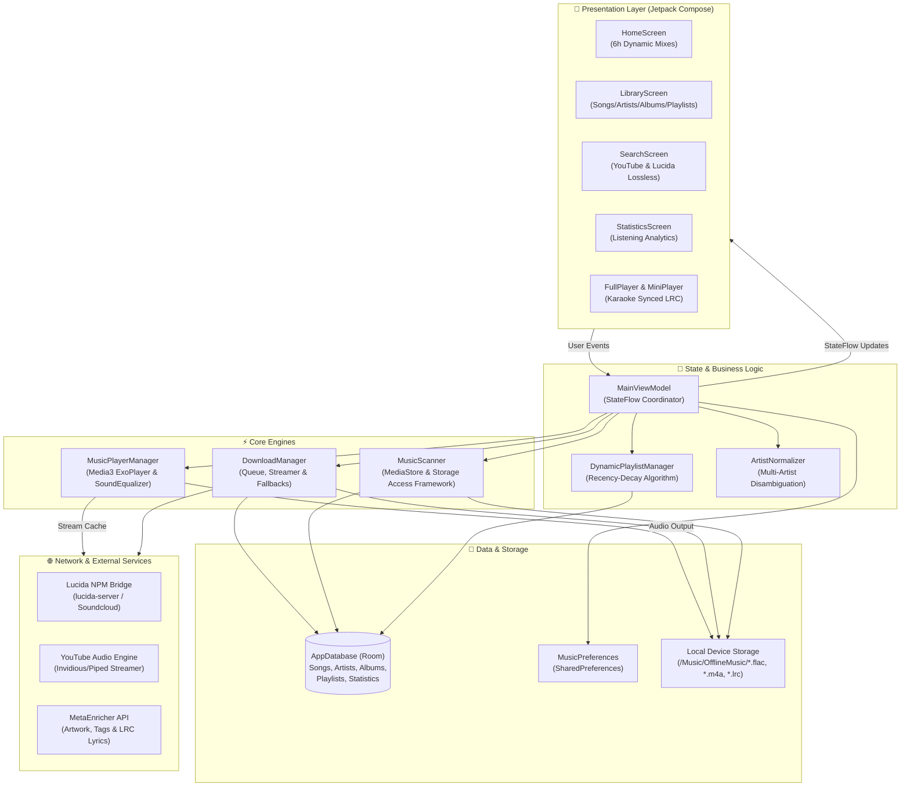
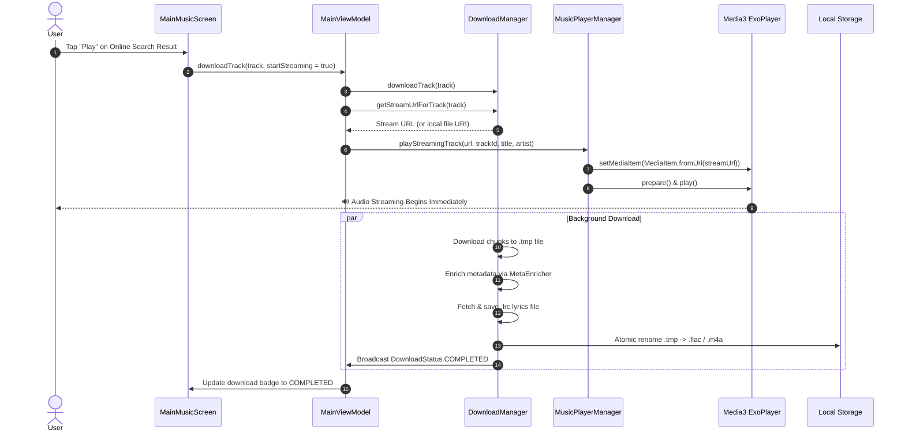

# 🏗️ BitTune System Architecture

This document provides a comprehensive technical overview of the architecture, data flow, reactive state management, and design patterns utilized in **BitTune (OfflineMusic)**.

---

## 📑 Table of Contents
- [High-Level Architecture](#high-level-architecture)
- [Layer Breakdown](#layer-breakdown)
  - [1. Presentation Layer (Jetpack Compose)](#1-presentation-layer-jetpack-compose)
  - [2. ViewModel & Reactive State (StateFlow)](#2-viewmodel--reactive-state-stateflow)
  - [3. Audio Playback Engine (Media3 & ExoPlayer)](#3-audio-playback-engine-media3--exoplayer)
  - [4. Data & Persistence Layer (Room & SharedPreferences)](#4-data--persistence-layer-room--sharedpreferences)
  - [5. Download & Archival Engine](#5-download--archival-engine)
- [Data Flow Diagram](#data-flow-diagram)
- [Playback & Streaming Lifecycle](#playback--streaming-lifecycle)
- [Database Schema & Relationships](#database-schema--relationships)

---

## High-Level Architecture

BitTune follows modern Android Architecture guidelines combining **MVI/MVVM**, unidirectional data flow (**UDF**), and a reactive event bus built upon Kotlin Coroutines and `StateFlow`.

---

## Layer Breakdown

### 1. Presentation Layer (Jetpack Compose)
- **100% Declarative UI**: Built with Android's modern Jetpack Compose toolkit and Material 3 design system.
- **Independent Record-Store Theme**: Custom color palette based on warm charcoal (`#191C19`), oatmeal (`#F5F2E9`), sage (`#A8B89A`), and clay (`#DBAE98`).
- **Reactive Screens**:
  - `HomeScreen`: Displays 6-Hour Dynamic Mixes, Quick Play cards, Recent Jams, and Favorites.
  - `LibraryScreen`: Tabs for Songs, Playlists, Artists, and Albums with sorting sheets.
  - `SearchScreen`: Unified search across local tracks, YouTube, and Lucida Lossless, plus 1-tap Spotify playlist URL batch importing.
  - `StatisticsScreen`: Visual charts, play count trackers, hour metrics, and mood distributions.
  - `FullPlayerSheet` & `MiniPlayer`: Swipeable bottom sheet with real-time synchronized `.lrc` lyrics display and built-in 5-band sound equalizer.

---

### 2. ViewModel & Reactive State (StateFlow)
- `MainViewModel` orchestrates the entire application state.
- Exposes cold/hot asynchronous data streams via `StateFlow` and `SharedFlow`:
  - `allSongs`, `allPlaylists`, `allAlbums`, `allArtists`
  - `onlineSearchResults`, `isOnlineSearching`
  - `downloads` (`Map<String, DownloadProgress>`)
  - `currentLyrics`, `currentLyricsIndex`
  - `showTutorial` (Onboarding walkthrough state)
- Ensures clean UI re-composition with zero memory leaks across configuration changes.

---

### 3. Audio Playback Engine (Media3 & ExoPlayer)
- Implemented in `MusicPlayerManager.kt`.
- Encapsulates `androidx.media3.exoplayer.ExoPlayer` with foreground service integration (`MediaSessionService`).
- **Features**:
  - **Gapless Playback**: Audio preroll and smooth track transitions.
  - **Dual Engine**: Plays local offline files (`File` / `ContentUri`) and live HTTP streams seamlessly.
  - **ExoPlayer Cache & Buffer**: YouTube and Lucida streams buffer on-the-fly while downloading proceeds concurrently in the background.
  - **5-Band Sound Equalizer**: Hardware-accelerated `android.media.audiofx.Equalizer` with customizable frequency bands (60Hz, 230Hz, 910Hz, 3.6kHz, 14kHz) and preconfigured audio presets.

---

### 4. Data & Persistence Layer (Room & SharedPreferences)
- **Room Database (`AppDatabase.kt`)**:
  - `SongEntity` / `TrackEntity`: Local songs, duration, file path, bitrate, mood, genre, play count, total listening time, and enrichment flags.
  - `ArtistEntity`: Canonical artists, aliases, and profile artwork.
  - `PlaylistEntity` & `PlaylistSongCrossRef`: Custom and dynamic playlists with position tracking.
  - `DownloadRecordEntity`: Download history, source (`YOUTUBE`, `LUCIDA`), and file locations.
  - `ListeningStatEntity`: Granular event logs of every playback session for the dynamic mix algorithm.
- **SharedPreferences (`MusicPreferences.kt`)**:
  - Selected music directory URI.
  - Equalizer band gain values.
  - Download source preference filter (`BOTH`, `YOUTUBE_ONLY`, `LUCIDA_ONLY`).
  - Active theme (`DEFAULT`, `DARK`, `LIGHT`, `AMOLED`).
  - `hasSeenTutorial` onboarding completion flag.

---

### 5. Download & Archival Engine
- Managed by `DownloadManager.kt`.
- Supports multi-engine concurrent downloads:
  - **YouTube Engine**: Extracts direct audio streams with seamless fallback.
  - **Lucida NPM Engine**: Talks to `lucida-server` (or native Soundcloud protocol) for FLAC and high-bitrate streaming.
  - **Spotify Playlist Client**: Resolves public Spotify playlists to track titles and searches candidate matches via multi-tier fuzzy matching (`FuzzyMatcher.kt`).
  - **MetaEnricher**: Post-download metadata enrichment (high-resolution artwork, canonical artist normalization, and synced `.lrc` lyrics file generation).

---

## Playback & Streaming Lifecycle

