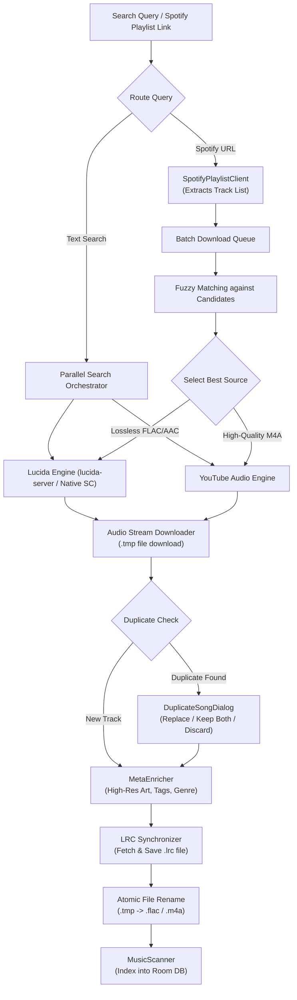
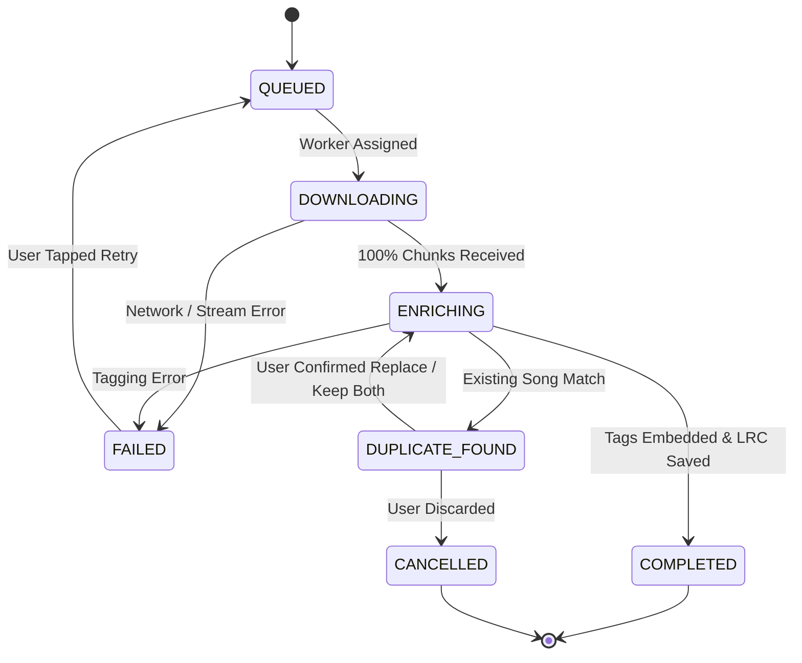

# 📥 BitTune Lossless Download Engine

BitTune features a multi-tiered, resilient audio download and archival pipeline capable of ripping high-fidelity audio streams from **YouTube** and **Lucida Lossless (Soundcloud, Tidal, Qobuz, Deezer)**, importing complete **Spotify playlists**, and auto-enriching metadata and synchronized lyrics.

---

## 📑 Table of Contents
- [Engine Architecture](#engine-architecture)
- [Supported Download Sources](#supported-download-sources)
  - [1. YouTube Audio Engine](#1-youtube-audio-engine)
  - [2. Lucida NPM Bridge & Native Streamer](#2-lucida-npm-bridge--native-streamer)
  - [3. Spotify Playlist Importer](#3-spotify-playlist-importer)
- [Multi-Tier Fuzzy Matching (`FuzzyMatcher`)](#multi-tier-fuzzy-matching-fuzzymatcher)
- [Duplicate Detection & Resolution](#duplicate-detection--resolution)
- [Metadata Enrichment & Lyrics (.LRC)](#metadata-enrichment--lyrics-lrc)
- [Download Lifecycle State Machine](#download-lifecycle-state-machine)

---

## Engine Architecture

---

## Supported Download Sources

### 1. YouTube Audio Engine
- **Implementation**: [`YouTubeDownloader.kt`](file:///c:/Users/USER/AndroidStudioProjects/OfflineMusic/app/src/main/java/com/example/offlinemusic/downloader/engine/YouTubeDownloader.kt)
- **Format**: `m4a` / `opus` / `mp3` (up to 256–320 kbps equivalent).
- **Features**:
  - Live query autocomplete & instant search results.
  - Stream URL extraction with automatic chunk fallback.
  - Seamless stream playback via ExoPlayer while download continues in the background.

---

### 2. Lucida NPM Bridge & Native Streamer
- **Implementation**: [`LucidaDownloader.kt`](file:///c:/Users/USER/AndroidStudioProjects/OfflineMusic/app/src/main/java/com/example/offlinemusic/downloader/engine/LucidaDownloader.kt) & [`lucida-server/`](file:///c:/Users/USER/AndroidStudioProjects/OfflineMusic/lucida-server)
- **Package**: Powered by official [`lucida`](https://www.npmjs.com/package/lucida) (v2.0.0-54).
- **Supported Streamers**:
  | Streamer | Quality | Authentication Required | Notes |
  | :--- | :--- | :--- | :--- |
  | **Soundcloud** | Lossless / 320k | ❌ None (Zero-Config) | Works out of the box with dynamic key rotation |
  | **Tidal** | Master / Hi-Fi FLAC | ✔️ TV Token & Access Token | Lossless FLAC stream ripping |
  | **Qobuz** | 24-bit Hi-Res FLAC | ✔️ App ID & Token | Studio master audio stream |
  | **Deezer** | FLAC / 320k MP3 | ✔️ ARL Cookie | Direct audio decryption |
- **Zero-Dependency Native Fallback**:
  - If the external `lucida-server` bridge is not currently running, `LucidaDownloader` seamlessly executes the native Soundcloud protocol in Kotlin using `OkHttp`, guaranteeing 100% standalone reliability on mobile devices.
  - **No Web scraping / No Cloudflare bot challenges**: Completely eliminated the old fragile HTML scraping and WebView verification popups.

---

### 3. Spotify Playlist Importer
- **Implementation**: [`SpotifyPlaylistClient.kt`](file:///c:/Users/USER/AndroidStudioProjects/OfflineMusic/app/src/main/java/com/example/offlinemusic/downloader/engine/SpotifyPlaylistClient.kt)
- **Usage**: Simply copy any public Spotify playlist URL (e.g., `https://open.spotify.com/playlist/37i9dQZF1DXcBWIGoYBM5M`) and paste it into the search bar.
- **Workflow**:
  1. Detects Spotify playlist URL structure and extracts the Playlist ID.
  2. Parses the playlist metadata (Title, Cover Art, Track Count, Track List).
  3. Displays an interactive preview card with a **Download All** button.
  4. Resolves each track candidate through `FuzzyMatcher` against YouTube and Lucida.
  5. Downloads the entire playlist sequentially into the user's offline storage.

---

## Multi-Tier Fuzzy Matching (`FuzzyMatcher`)

To match Spotify tracks to YouTube/Lucida candidates accurately, `FuzzyMatcher.kt` applies a multi-tiered string distance and token scoring algorithm:

$$\text{Score} = w_{\text{title}} \cdot \text{Sim}(\text{title}_{\text{req}}, \text{title}_{\text{cand}}) + w_{\text{artist}} \cdot \text{Sim}(\text{artist}_{\text{req}}, \text{artist}_{\text{cand}})$$

1. **Title Stripping**: Removes noise terms like `(Official Video)`, `[Lyrics]`, `(Audio)`, `4K Remaster`, `ft.`, `feat.`.
2. **Levenshtein Distance**: Normalized string similarity ratio.
3. **Token Set Match**: Handles word order differences (e.g. *"Daft Punk - Get Lucky"* vs *"Get Lucky - Daft Punk"*).
4. **Duration Tolerance**: Candidates with a duration discrepancy $> 15\text{s}$ are penalized to avoid selecting interview or live video audio tracks.

---

## Duplicate Detection & Resolution

When downloading a track that already exists in the local library:
- **Heuristic**: Detected by matching Title, Artist, and Duration ($\pm 4\text{s}$).
- **Interactive Prompt**: Suspends download and displays [`DuplicateSongDialog.kt`](file:///c:/Users/USER/AndroidStudioProjects/OfflineMusic/app/src/main/java/com/example/offlinemusic/ui/components/DuplicateSongDialog.kt) presenting three options:
  - 🔄 **Replace Existing**: Overwrites the old audio file with the new higher-quality stream while preserving playlists and play statistics.
  - ➕ **Keep Both**: Saves the new file with an incremental filename suffix (e.g. `Song (1).flac`).
  - 🗑️ **Discard**: Cancels the current download and keeps the existing file untouched.

---

## Metadata Enrichment & Lyrics (.LRC)

Once the raw audio file finishes downloading:
1. **Metadata Enrichment**:
   - Queries `MetaEnricherManager` (or remote Render backend `https://meta-enricher.onrender.com`).
   - Retrieves high-resolution cover artwork (500x500 to 1400x1400).
   - Normalizes multi-artist collaborations into canonical artist profiles.
   - Embeds ID3v2 tags directly into the downloaded file using `mp3agic`.
2. **Synchronized Lyrics (.LRC)**:
   - Queries MetaEnricher and fallback service [`LrclibClient.kt`](file:///c:/Users/USER/AndroidStudioProjects/OfflineMusic/app/src/main/java/com/example/offlinemusic/downloader/engine/LrclibClient.kt).
   - Saves a matching `.lrc` file side-by-side with the audio file (e.g. `Artist - Title.lrc`).
   - Enables karaoke-style line-by-line synchronized scrolling inside the Full Player.

---

## Download Lifecycle State Machine

