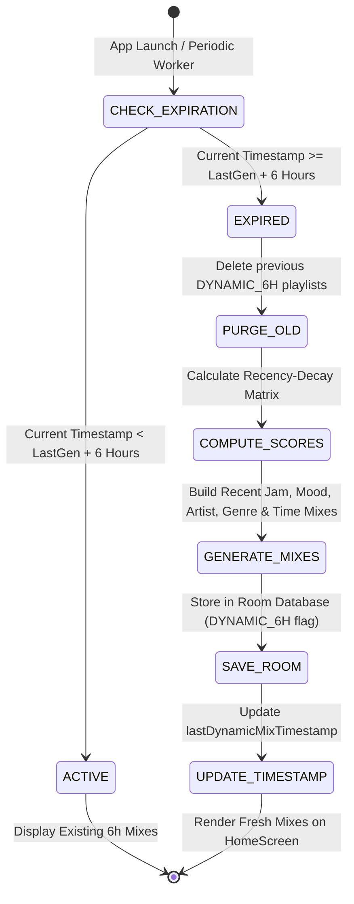

# ⏱️ 6-Hour Dynamic Mix Engine

BitTune includes an intelligent, autonomous playlist generation engine ([`DynamicPlaylistManager.kt`](file:///c:/Users/USER/AndroidStudioProjects/OfflineMusic/app/src/main/java/com/example/offlinemusic/data/repository/DynamicPlaylistManager.kt)) that computes your listening patterns and automatically curates fresh playlists **every 6 hours**.

---

## 📑 Table of Contents
- [Overview & Philosophy](#overview--philosophy)
- [Recency-Decay Scoring Algorithm](#recency-decay-scoring-algorithm)
- [Mix Archetypes](#mix-archetypes)
  - [1. Recent Jam](#1-recent-jam)
  - [2. Top Mood Mix](#2-top-mood-mix)
  - [3. Artist Spotlight](#3-artist-spotlight)
  - [4. Genre Mix](#4-genre-mix)
  - [5. Time-of-Day Vibe](#5-time-of-day-vibe)
- [Lifecycle & Auto-Expiration](#lifecycle--auto-expiration)
- [Decision Pipeline Diagram](#decision-pipeline-diagram)

---

## Overview & Philosophy

Static playlists quickly grow stale. BitTune replaces manual playlist maintenance with a self-evolving dynamic engine:
- **Zero Cloud Dependence**: All listening telemetry and scoring are calculated **100% locally** on your device.
- **Recency-First Priority**: What you were obsessed with 4 hours ago heavily impacts your current mix, while historical listening stabilizes long-term preferences.
- **Auto-Expiring Ephemeral Playlists**: Mixes are created for a 6-hour window and safely refreshed when the window expires.

---

## Recency-Decay Scoring Algorithm

Every track play event logs a timestamped record. To prioritize recent favorites over historical background noise, tracks receive a recency-weighted score:

$$\text{Score}(t) = \sum_{e \in \text{Events}(t)} w(\Delta t_e) \cdot \text{DurationWeight}(e)$$

Where $\Delta t_e = \text{CurrentTime} - \text{Timestamp}(e)$:

| Time Since Play ($\Delta t_e$) | Weight Multiplier ($w$) | Impact |
| :--- | :--- | :--- |
| **$< 12$ hours** | **$6.0\times$** | 🔥 Highest priority (Immediate Jam) |
| **$12 - 24$ hours** | **$4.0\times$** | ⚡ High priority (Today's rhythm) |
| **$1 - 3$ days** | **$2.5\times$** | 📈 Medium priority (Recent habit) |
| **$4 - 7$ days** | **$1.2\times$** | 🎵 Moderate priority (Weekly trend) |
| **$> 7$ days** | **$0.5\times$** | 🏛️ Baseline historical preference |

---

## Mix Archetypes

Every 6 hours, the engine analyzes your scored catalog and builds up to 5 distinct dynamic mixes:

### 1. Recent Jam
- **Focus**: The songs you currently have on repeat.
- **Selection**: Ranked strictly by highest aggregate recency-decay score over the preceding 24–48 hours.

### 2. Top Mood Mix
- **Focus**: The emotional tone dominating your recent listening sessions.
- **Mood Clusters**: *Happy / Uplifting*, *Chill / Relaxed*, *Energetic / Workout*, *Melancholic / Sad*, *Romantic / Intimate*.
- **Selection**: Identifies the highest-scoring mood cluster and compiles top tracks matching that mood tag.

### 3. Artist Spotlight
- **Focus**: A deep dive into your most-listened-to artist of the moment.
- **Selection**: Selects the top-ranked artist from recent scores, compiling their top tracks mixed with deep cuts from your local library.

### 4. Genre Mix
- **Focus**: The genre you are currently gravitating toward (e.g. *Electronic*, *Hip-Hop*, *Indie Rock*, *Classical*).
- **Selection**: Scored by cumulative genre play time, curating 15–25 matching tracks.

### 5. Time-of-Day Vibe
- **Focus**: Adapts to the current time of day:
  - 🌅 **06:00 – 11:59**: *Morning Coffee* (Acoustic, Ambient, Gentle Indie)
  - ☀️ **12:00 – 17:59**: *Midday Energy* (Pop, Rock, Upbeat Rhythms)
  - 🌆 **18:00 – 22:59**: *Evening Wind Down* (Lo-Fi, Jazz, R&B)
  - 🌙 **23:00 – 05:59**: *Late Night Vibe* (Deep House, Synthwave, Chill)

---

## Lifecycle & Auto-Expiration

